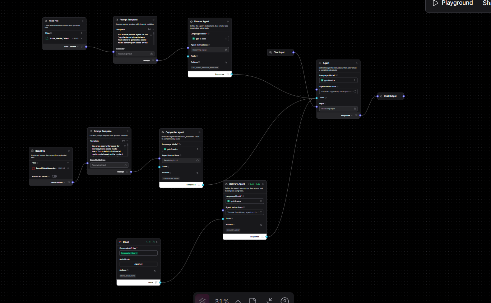
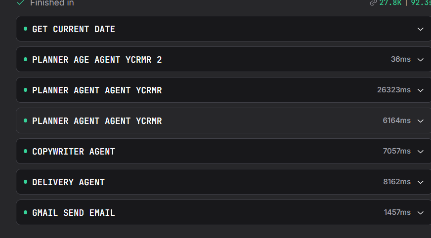
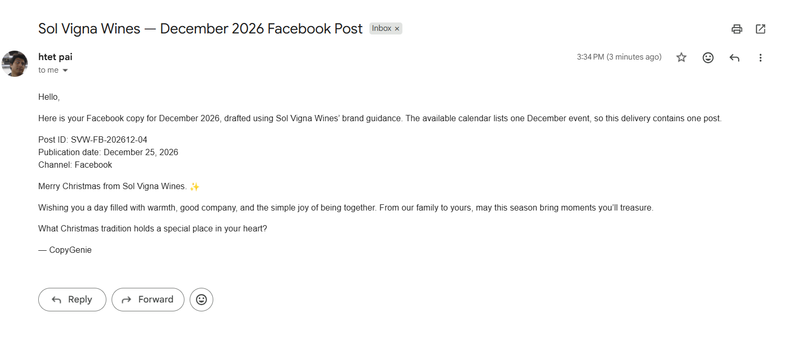

# CopyGenie: Hierarchical Multi-Agent Team

A supervisor agent that coordinates three specialist agents to plan, write, and email social media posts for a winery.

## The team
- **Supervisor:** talks to the user and decides which agent to call
- **Planner Agent:** builds a posting schedule from a social media calendar
- **Copywriter Agent:** writes posts that follow the brand guidelines
- **Delivery Agent:** sends the final posts by email (Gmail through Composio)

## Key concepts
- Hierarchical (Type 2) agent structure: agents used as tools by another agent
- Tool descriptions decide when the supervisor calls each agent
- Embedding small documents directly in prompts instead of using RAG
- Real-world actions through Composio (scoped API keys and OAuth)
- The tool-calling loop: model asks for a tool, the code runs it and returns the result, repeat

## Langflow flow


## Agent calls behind one request


## Result


## Run the Python version
```bash
python copygenie.py
```
Needs `OPENAI_API_KEY`, `COMPOSIO_API_KEY`, `COMPOSIO_USER_ID`, and `COMPOSIO_AUTH_CONFIG_ID` in a `.env` file, plus the calendar CSV and brand guidelines file in this folder (not included).

## Reference
Learning source: Grokking AI Applications
