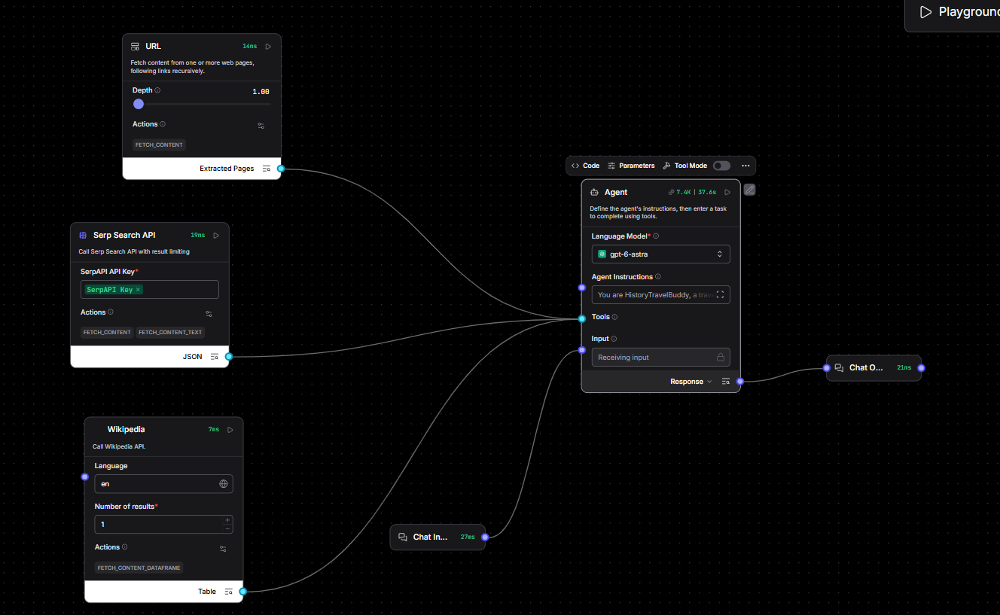

# HistoryTravelBuddy: Tool-Using Agent (LangChain)

An AI agent that plans history-focused one-day trips. It decides on its own which tools to use.

## Tools
- **web_search:** Google search through SerpApi to find attractions
- **fetch_url:** opens a web page and reads its text
- **Wikipedia:** finds historical facts and links for each place

## How it works
The agent gets the user's request, picks tools, reads their results, and repeats until it can write a full itinerary with historical facts and Wikipedia links.

## Key concepts
- Turning Python functions into tools with `@tool` (the docstring becomes the tool description)
- Agent instructions that tell the model when to use tools
- AgentExecutor loop: think, act, observe, repeat

## Run
```bash
python history_travel_buddy.py
```
Needs `OPENAI_API_KEY` and `SERP_API_KEY` in a `.env` file. Set `verbose=True` to see tool calls.

## Reference
Grokking AI Applications

## Langflow flow

