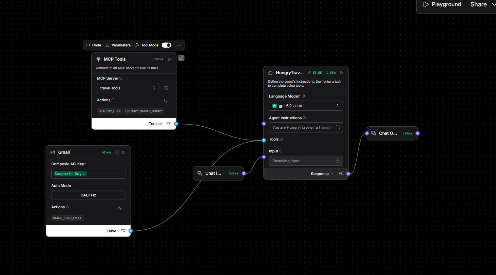
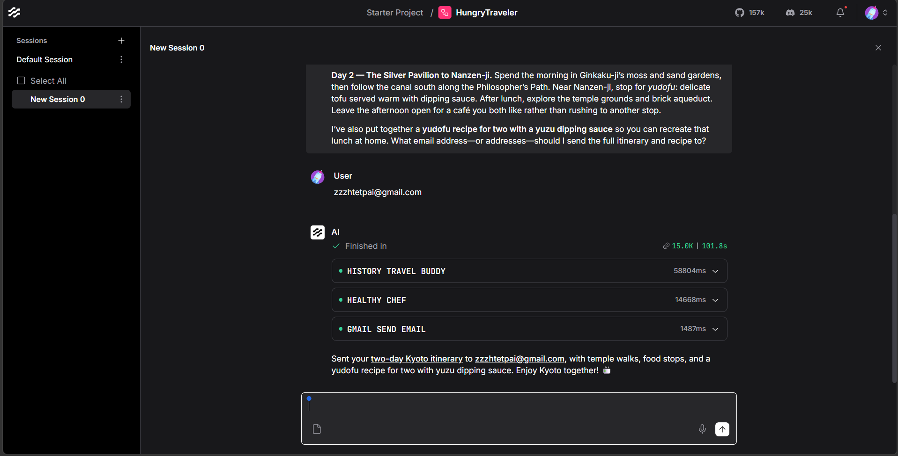
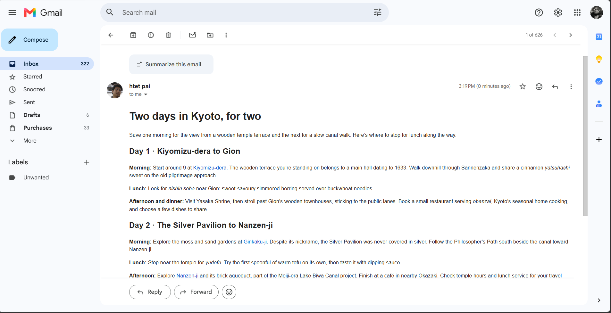

# HungryTraveler (MCP + Gmail Agent)

An AI travel companion built in Langflow. It chats with the user, plans a history-focused trip, creates a healthy recipe inspired by the destination, and sends everything in an HTML email.

## How it works
- **Agent (HungryTraveler):** talks to the user and decides which tool to use
- **MCP Tools:** reuses two of my earlier Langflow flows as tools through Langflow's MCP server
  - `history_travel_buddy`: makes the itinerary (SerpApi, URL, Wikipedia)
  - `healthy_chef`: chef and dietitian flow that makes a healthy recipe
- **Gmail (Composio):** sends the final email



## Result



## Coded version (MCP in Python)
- `calculator_mcp_server.py`: a small MCP server built with FastMCP, with one tool `add(a, b)`
- `calculator_mcp_client.py`: starts that server, lists its tools, and calls `add`
- `travel_tools_mcp_client.py`: connects to my Langflow MCP server (travel-tools), lists the tools, and calls the `healthy_chef` flow from Python

```bash
pip install fastmcp mcp python-dotenv
python calculator_mcp_server.py 4 5
python calculator_mcp_client.py
python travel_tools_mcp_client.py   # needs Langflow running + .env with LANGFLOW_MCP_URL and LANGFLOW_API_KEY
```

## What I learned
- **MCP:** one flow can be shared as a tool for other flows, apps, and code (like a USB-C port for tools)
- **Tool descriptions matter:** the agent picks tools based on their descriptions
- **Silent failures:** once, the chef tool failed in about 60ms and the agent still wrote a recipe by itself. I only noticed by checking tool timings, which shows why observability matters
- **After restarting Langflow, refresh the MCP Tools box**, or old connections fail with "I/O operation on closed file"
- **LangSmith:** set up an account, key and agent for tracing, but LangSmith's new agent-based setup didn't work with Langflow 1.12.4, so I ran without it

## Stack
Langflow 1.12.4, OpenAI, MCP (Streamable HTTP), FastMCP, Composio Gmail

Reference: Grokking AI Applications
